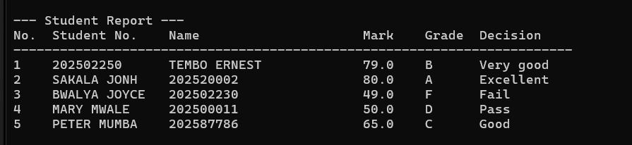
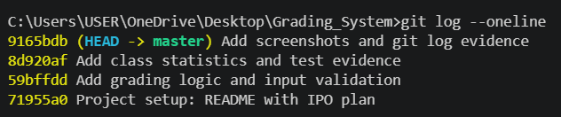

# ICT111 Lab: Student Grading System

**Name:** _TEMBO_ERNEST  
**Student number:** _202502250_  
**Course:** ICT111 – Principles of Programming (Python & Git)  
**Institution:** Mulungushi University, School of Engineering and Technology

---

## Task 1: Plan

### Grading scale (lab scale only)

| Score range | Grade | Decision  |
|-------------|-------|-----------|
| 80–100      | A     | Excellent |
| 70–79       | B     | Very good |
| 60–69       | C     | Good      |
| 50–59       | D     | Pass      |
| 0–49        | F     | Fail      |

### Input – Process – Output (IPO) plan

| Stage       | Description |
|-------------|-------------|
| **Input**   | Menu choice (1–4). For each new student: student number, name and mark. |
| **Process** | Show the menu repeatedly in a `while` loop. Validate the student number and name (not blank) and the mark (numeric, 0–100), re-prompting until valid. Use `if/elif/else` to work out the grade and decision. Store the record as a dictionary and append it to the `students` list. Loop over `students` with `for` to display the report and to calculate total, average, highest, lowest, passes and fails. |
| **Output**  | Confirmation after each record is added, a formatted report of all students, a class summary (total, average to 2 d.p., highest, lowest, passes, fails), and clear error or warning messages (invalid mark, empty class, invalid menu option). |

### Why a list of dictionaries?

- Each student has several related pieces of data (student number, name, mark, grade, decision). A **dictionary** keeps them together under meaningful keys, e.g. `student["mark"]`, which is clearer than remembering index positions.
- A **list** holds many such dictionaries, in the order they were added, and can grow as new students are added.
- A `for` loop can go through the list easily to print reports and calculate statistics.
- `len(students)` immediately tells us whether the class is empty.

---

## Task 2 and 3: How to run

```
python grading_system.py
```

Menu options: **1** Add student, **2** Display all, **3** Class summary, **4** Exit.

---

## Task 4: Test evidence

| Test | Input or action | Expected behaviour | Observed result | Pass/Fail |
|------|-----------------|--------------------|-----------------|-----------|
| T1 | Add 79, then 80 | B then A; both pass | 79 → Grade B (Very good); 80 → Grade A (Excellent). Both counted as passes. | Pass |
| T2 | Add 49, then 50 | F then D; fail then pass | 49 → Grade F (Fail); 50 → Grade D (Pass). | Pass |
| T3 | Enter -1, 101, or "abc" as mark | Reject; ask again; no crash | -1 and 101 gave "mark must be between 0 and 100"; "abc" gave "mark must be a number". Program re-prompted each time and did not crash. | Pass |
| T4 | Display summary before adding students | No division by zero; informative message | Printed "No students have been added yet, so there is no summary to show." No error. | Pass |
| T5 | Choose an invalid menu option | Display warning; return to menu | Printed "Invalid option! Please enter 1, 2, 3 or 4." and the menu was shown again. | Pass |

### Full run with five students

Students added: 79 (B), 80 (A), 49 (F), 50 (D), 65 (C).

Class summary observed:

```
Total students : 5
Class average  : 64.60
Highest mark   : 80.0
Lowest mark    : 49.0
Passes (>= 50) : 4
Fails  (< 50)  : 1
```

Average check: (79 + 80 + 49 + 50 + 65) / 5 = 323 / 5 = 64.60.

### Screenshots





---

## Task 5: Git history

_Paste the output of  here:_

```
(example)
c3d4e5f Add class statistics and test evidence
b2c3d4e Add grading logic and input validation
a1b2c3d Project setup: menu, README plan
```

---

## Reflection

**1. Why does the order of if/elif conditions matter at grade boundaries?**  
Python checks conditions from top to bottom and runs only the first one that is true. Because the conditions start at the highest band (`mark >= 80`) and work down, a mark such as 85 is caught as A and never reaches the lower checks. If the order were reversed (e.g. `mark >= 50` first), every mark of 50 or more would be graded D, and the A, B and C branches would never run. Correct order also makes boundary marks like 79/80 and 49/50 fall into the right grade.

**2. What error could arise when calculating the average of an empty list?**  
Dividing the total by zero (`0 / len(students)`) raises a `ZeroDivisionError` and crashes the program. This is avoided by checking `len(students) == 0` first and printing a message instead of calculating.

**3. How would you adapt the program to handle two courses per student?**  
Add a `courses` key to each student dictionary whose value is a list of dictionaries, one per course, each holding the course code, mark, grade and decision. For example:

```python
{"student_number": "S001", "name": "Alice",
 "courses": [{"course": "ICT111", "mark": 79, "grade": "B", "decision": "Very good"},
             {"course": "ICT112", "mark": 65, "grade": "C", "decision": "Good"}]}
```

The add-student option would ask for two course marks, and a nested `for` loop would display and summarise the marks per course (and optionally an overall average per student).
